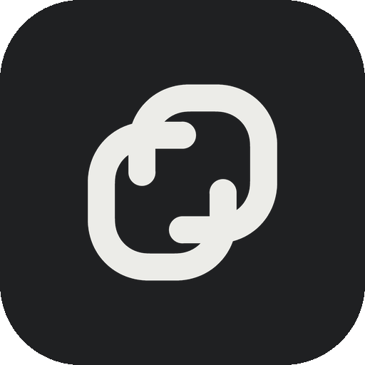
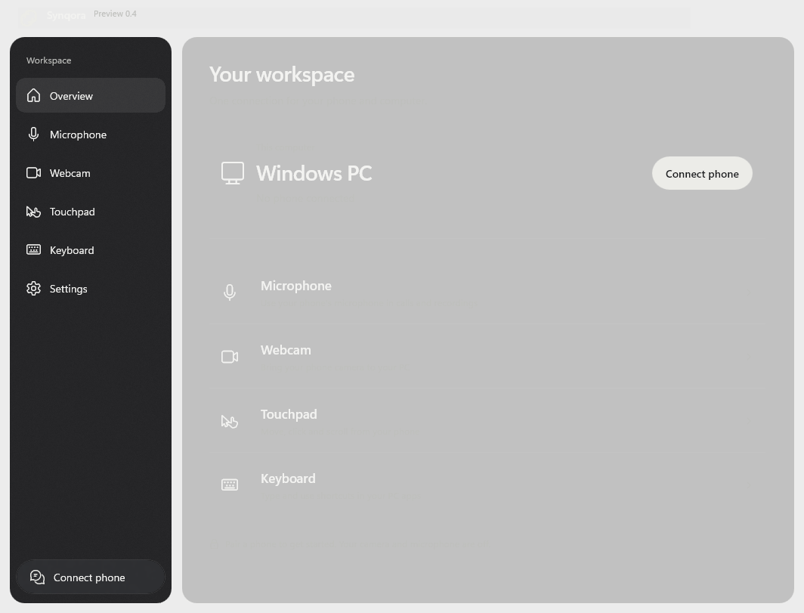
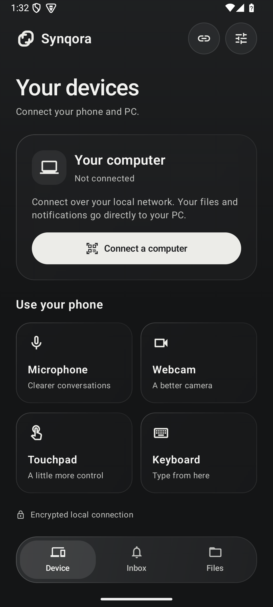

# Synqora



**An Android and Windows companion for files, photos, notifications, calls and remote controls.**

Synqora connects directly over your local network. It has native Windows and Android apps, a dark glass interface, and no cloud account in the connection path.

**Current release: [0.5.0 development preview](https://github.com/divya-abhishek/Synqora/releases/tag/v0.5.0-dev).** This is a test build. Physical-phone performance, external microphone capture and installation lifecycle testing are still in progress. It is not a finished replacement for a production device driver.

<p>


</p>

[See the native app screens](docs/SCREENSHOTS.md) · [Installation and troubleshooting](docs/INSTALLATION.md) · [Validation and known limits](docs/VALIDATION.md)

## What it does

| Feature | On your phone | On your PC |
| --- | --- | --- |
| Files | Pick files or accept incoming transfers | Send/receive with consent, storage checks and SHA-256 verification; no fixed 1 GB cap |
| Photos & videos | Opt in to library or selected-media access | Browse paged thumbnails and save selected originals |
| Notifications | Opt in to Android notification access and sync | Read, dismiss and reply through each app's real inline-reply action |
| Call history | Grant call-log access separately | View recent cellular calls and select a number for dialing |
| Calling | Explicitly allow PC call requests | Direct dialing; experimental Windows HFP implementation in the separate MSIX, pending physical-device acceptance |
| Microphone | Capture, mute and adjust input gain | Receive audio; route it to the optional VB-CABLE recording device |
| Webcam | Preview, flip cameras, choose quality and dim the display | Preview video and publish **Synqora Camera** to Windows apps |
| Touchpad | Move, tap, click and scroll | Control the pointer after allowing remote input |
| Keyboard | Type, edit and use shortcuts live | Send keystrokes to the currently focused app; no Send button |

Audio/video and remote input use separate bounded transport lanes. Pairing authenticates an encrypted TLS connection with a short-lived invitation and certificate pin. An Android foreground session keeps the connection active while the app backgrounds or the display sleeps, subject to Android and device policy.

### Companion setup

- **Files:** choose a file on either device. Incoming transfers ask for approval. PC saves go to `Downloads/Synqora`; Android uses its system save picker. There is no fixed file-size cap, but receiving needs sufficient storage. Android stages and verifies the file locally before copying it to your chosen destination.
- **Photos:** on the phone open **Files → Photos and videos**, enable gallery sharing and choose Android photo access. On PC open **Photos**. Thumbnails load on demand; **Save original** transfers that item. Gallery sync does not copy the entire library automatically or open the camera.
- **Notifications:** on the phone open **Inbox**, enable sync and grant notification access. Replies work only where the source notification provides an inline reply. An app may require unlocking the phone or restrict its actions.
- **Calls:** on the phone open **Inbox → Call settings**. History and placing calls have separate opt-ins and permissions. Android/installer policy can restrict call-log access. The normal MSI can request a call using the phone's audio route. The separate **experimental calling MSIX** declares the Windows Bluetooth phone capabilities and implements HFP dialing, active-call controls and PC/phone audio routing. Hardware and MSIX installation acceptance remain open; see [calling setup](docs/CALLING.md).

WhatsApp's private call history and direct outgoing-call API are not available to Synqora. Notification actions and Bluetooth-exposed calls depend on the calling app and phone. This preview is not yet a complete Phone Link calling replacement.

### Background power

An idle companion holds no camera, microphone or CPU wake lock. Capture stops when the PC connection is lost, including media-lane failure, and does not restart on reconnect. Swiping away the phone app stops capture; a connected idle companion may remain. Explicitly started media can continue with the screen locked. Android may defer idle delivery in Doze. A short emulator CPU sample is not a two-hour physical-phone battery result.

The PC offers **Settings → Minimize to notification area** and **Keep running when the window closes**. Use the tray menu to reopen or quit. Hidden/minimized windows pause decorative preview work while media delivery continues. A custom inline taskbar widget is not included.

## Requirements

| | Requirement |
| --- | --- |
| PC app | Windows 10 version 2004 / build 19041 or newer, **64-bit x64** |
| Webcam in Meet / Camera / other apps | **Windows 11**, installed MSI camera component |
| Phone | **Android 10 or newer**, with microphone/camera access for the features you start |
| Network | Phone and PC on a reachable local network; guest-network isolation or a firewall may block pairing |
| Microphone in other apps | One-time **VB-CABLE** vendor setup and Windows restart; details below |

The MSI bundles the app's .NET, Windows App SDK, graphics and Visual C++ runtimes. A separate .NET installation is not required. The phone APK includes its app libraries. The microphone component still requires its own setup; including its installer is not the same as installing the driver.

## Install and connect

1. Open the [0.5.0 preview release](https://github.com/divya-abhishek/Synqora/releases/tag/v0.5.0-dev). Download the **Windows MSI** and **Android APK**. The ZIP is a portable client for testing and does not register the camera component.
2. Close Synqora and camera-consuming apps, then run the MSI. On Android, install the APK using the device's normal package installer. Preview Windows installers are not production code-signed.
3. Open Synqora on the PC and choose **Connect phone**. On Android, choose **Connect a computer** or the link icon, then **Scan PC code**. Pasting the pairing link also works. Invitations expire after ten minutes.
4. Start Microphone or Webcam on the phone. Allow the corresponding Android permission when prompted. Keep the active-session notification available so you can disconnect.
5. For Touchpad and Keyboard, enable **Allow phone keyboard & pointer** on the PC. Focus the destination PC app before typing. Disconnecting revokes remote-input permission.

**Android installation notice:** the APK has a verified release signature, but a tester has reported Play Protect's sensitive-permission block. The optional notification listener matches Google's documented trigger for downloaded APKs. Re-signing does not grant Google approval. See [signing identity and review guidance](docs/ANDROID-SECURITY.md) and [data handling](docs/PRIVACY.md).

### Microphone setup for Meet and other apps

The phone microphone reaching Synqora does **not** by itself create a Windows recording device.

1. In the Windows app, open **Microphone → Setup → Open bundled setup folder**.
2. Run the original **VBCABLE_Setup_x64.exe** as administrator and restart Windows.
3. In Meet, your recorder or another audio app, choose **CABLE Output (VB-Audio Virtual Cable)** as the microphone.
4. Start the phone microphone and use **Share with apps** in Synqora if routing has not started automatically.

VB-CABLE's **Input** is the playback endpoint Synqora writes to; **Output** is the recording endpoint other apps select. Keep your normal speakers/headphones as Windows output if vendor setup changes the default. Synqora does not silently install this component or change your default devices.

VB-CABLE is © Vincent Burel / VB-Audio Software and is **donationware**. The original archive, readme and signed vendor binaries are included unchanged. [Vendor download and support](https://vb-audio.com/Cable/) · [Licensing and redistribution terms](https://vb-audio.com/Services/licensing.htm). Please support its developer.

### Webcam setup

Install the MSI on Windows 11, then start the phone camera. Synqora attempts to publish **Synqora Camera** and checks that Windows can enumerate it and capture a sample before reporting it available. Select it in Meet or your camera app. If the device list was already open, reopen it after starting sharing.

The portable ZIP does not register the camera source. Upgrading requires closing camera consumers so the MSI can replace the old component. Fit/Fill settings change the actual virtual output framing; Fill crops rather than stretches.

## Current limitations

- Requested 60 FPS depends on the phone camera, lighting and network. Emulator throughput varies with host load; sustained physical-phone 60 FPS is not verified.
- Physical-phone streaming frame-time and multi-hour battery acceptance remain open. See [measured validation](docs/VALIDATION.md) for the scope and actual results.
- External-app microphone capture, clean-machine offline install, upgrade/uninstall and physical-device acceptance remain open.
- The original Synqora audio-driver research is unsigned and excluded from consumer packages. VB-CABLE is the available optional route.
- Input into elevated Windows apps can be blocked by Windows. Consumer USB setup and automatic reconnect are unfinished.
- Windows uses native thin acrylic. Android uses restrained layered glass and immediate navigation. Phone and PC are dark-only. Older or constrained devices use fallbacks. Apple's exact proprietary rendering and physics are not included.

## Build from source

Windows requires a .NET SDK capable of building .NET 8 and Windows SDK 10.0.26100 or newer for the Bluetooth calling APIs. The ordinary client still targets Windows 10 build 19041 at runtime; Bluetooth calling and the virtual camera require Windows 11. Build camera code from an x64 Visual Studio developer prompt, or supply the ignored local toolchain setup used by the build script. Android requires JDK 17+ and SDK 35; configure `ANDROID_HOME` or ignored `android/local.properties`.

```powershell
python tools/generate_tokens.py --check
python tools/check_design.py
tools/build_camera.cmd
dotnet build windows/Synqora/Synqora.csproj -c Release
android/gradlew.bat -p android assembleDebug lintDebug testDebugUnitTest
```

Use `tools/package_windows.ps1 -Development` and `tools/package_android.ps1 -Development` for review packages. Android release packaging requires your own local signing configuration; private signing material is not in this repository. Production packaging is gated by `release-gates.json`.

After Windows publishing, `tools/package_calling_msix.ps1` builds the optional experimental calling package and a public preview certificate. It signs files only; it does not install the package or change certificate trust. Read [calling setup and acceptance limits](docs/CALLING.md) before testing it.

Windows review packaging also expects the unchanged vendor `VBCABLE_Driver_Pack45.zip` in `.local/vbcable/`. Obtain it from [VB-Audio](https://vb-audio.com/Cable/); the package script verifies the reviewed archive hash. It is included in downloadable review releases, not committed to the source repository.

Native screenshot and integration tools live in `tools/`. [Design implementation](docs/DESIGN.md) · [Device integration](docs/DEVICE-INTEGRATION.md) · [Validation](docs/VALIDATION.md).

## License

Synqora application source is [MIT licensed](LICENSE). The separate `native/audio/` research component and `tools/prepare_audio.py` are [MS-PL](native/audio/LICENSE.SysVAD.txt). Bundled libraries and the optional VB-CABLE distribution retain their own terms; see [third-party notices](THIRD-PARTY-NOTICES.md). No WO Mic, DroidCam or Apple assets are bundled.
