# Synqora screenshots

These are native WinUI 3 and Jetpack Compose captures from the 0.4 development preview. They show the actual disconnected app, not generated mockups. Windows capture mode substitutes “Windows PC” for the host's personal device name. App-only captures do not reproduce the desktop scene seen through native acrylic; the material changes with the OS, background and accessibility settings.

## Windows

| Screen | Dark | Light |
| --- | --- | --- |
| Dashboard |  | 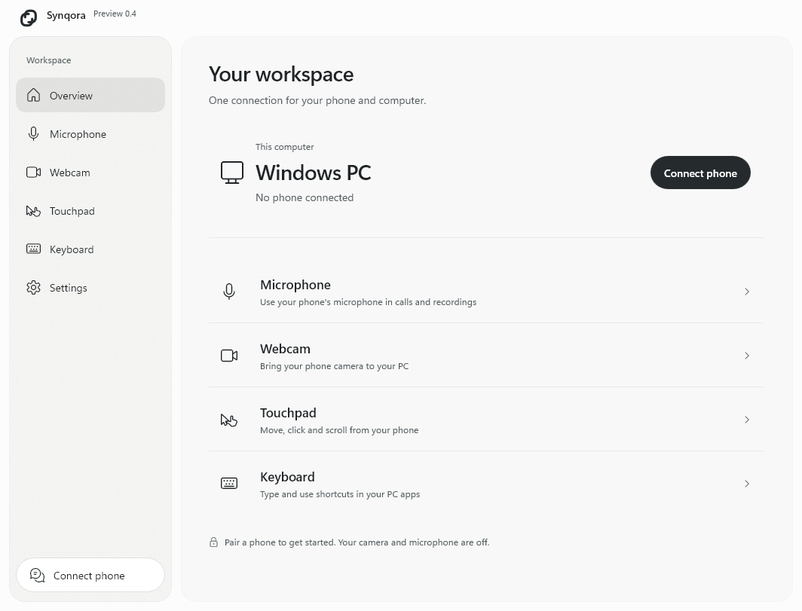 |
| Microphone |  | 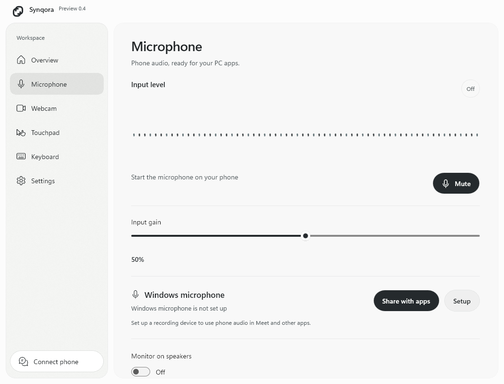 |
| Webcam |  | 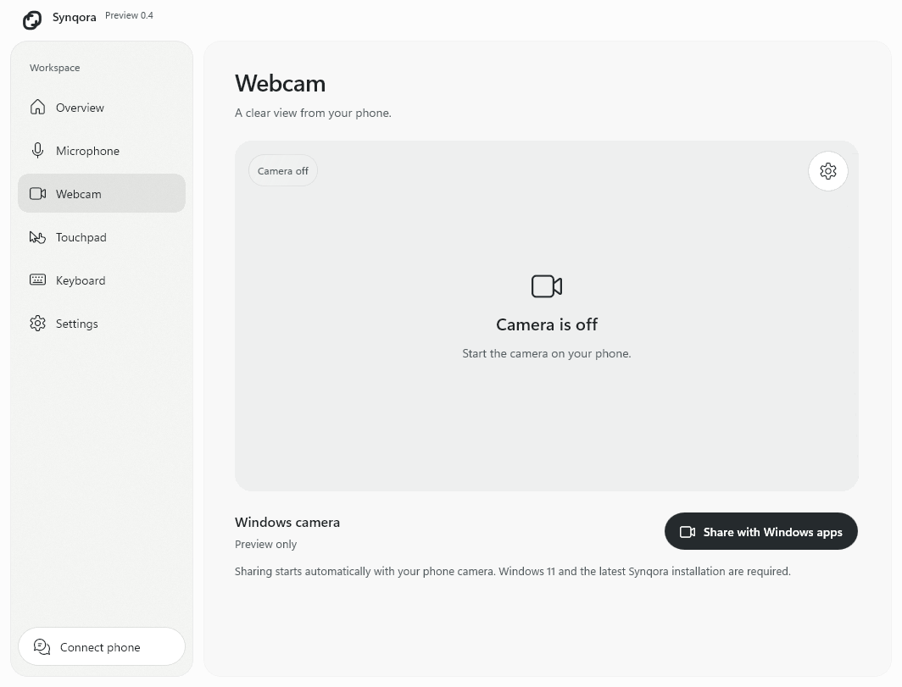 |
| Touchpad |  | 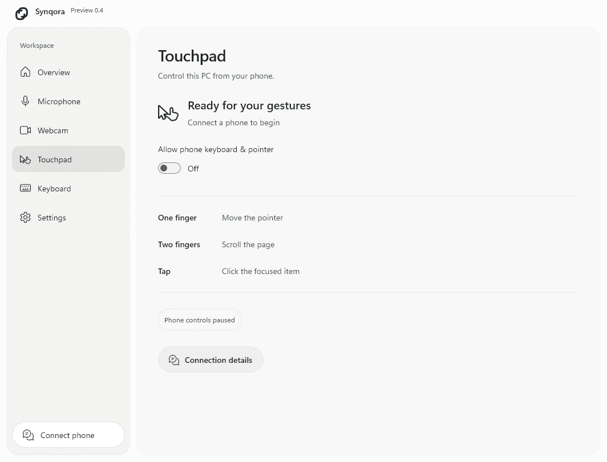 |
| Keyboard |  | 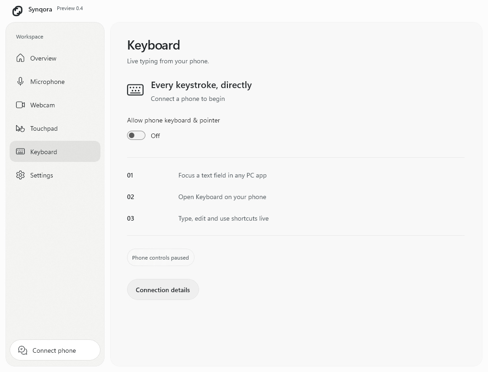 |
| Settings |  | 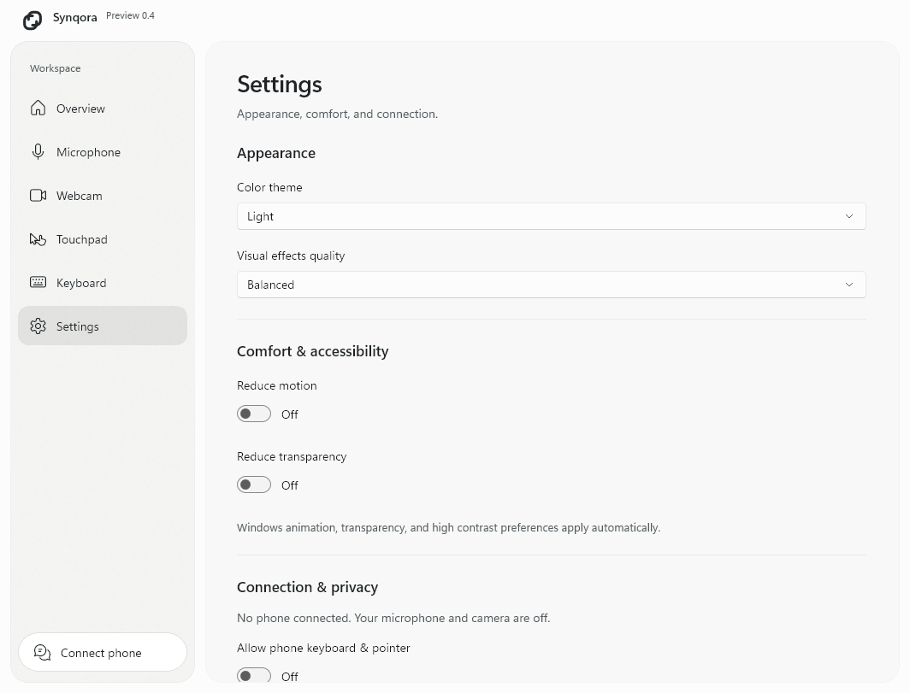 |

## Android

| Screen | Dark | Light |
| --- | --- | --- |
| Dashboard |  | 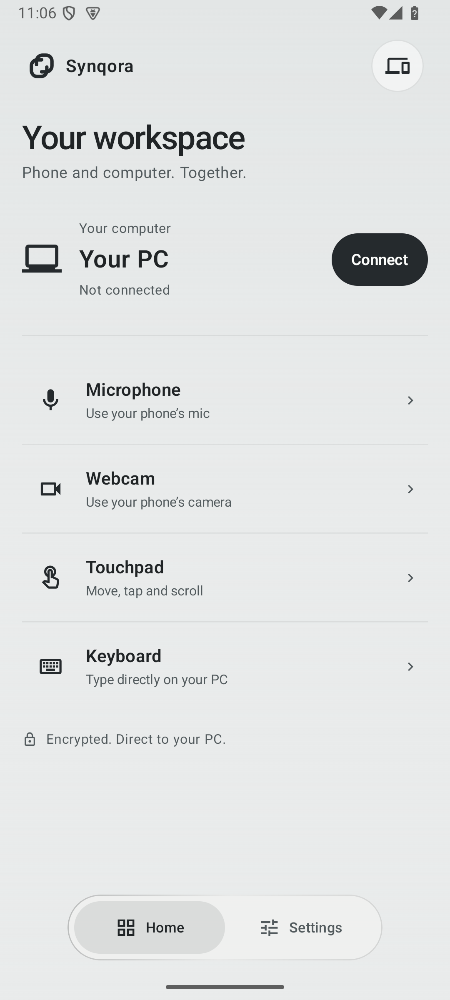 |
| Microphone |  | 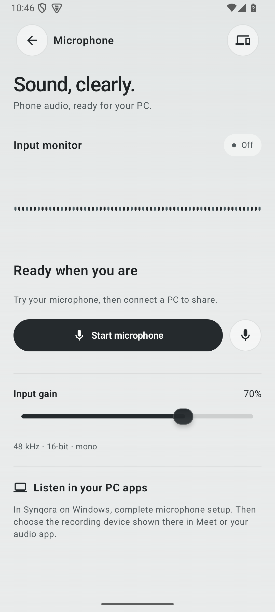 |
| Webcam |  | 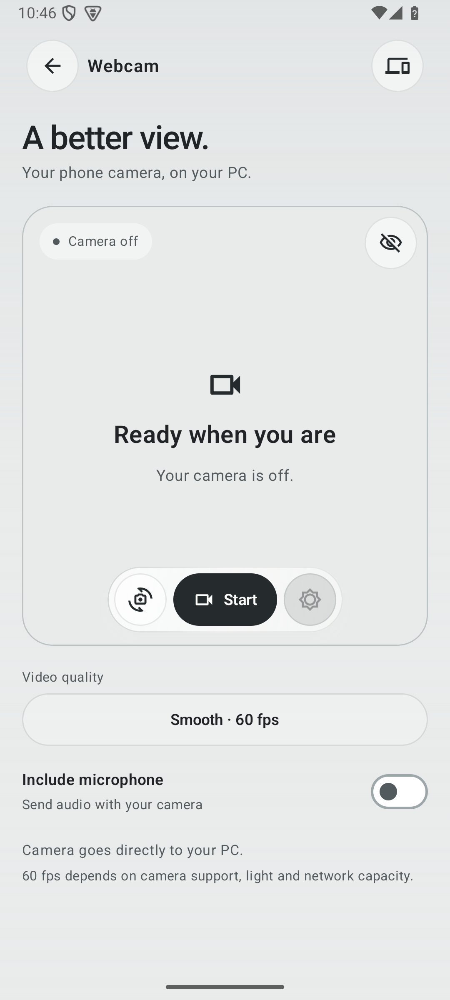 |
| Touchpad |  | 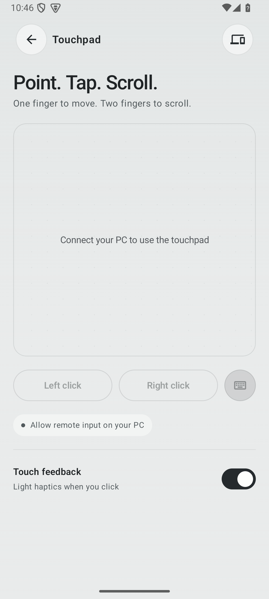 |
| Keyboard |  | 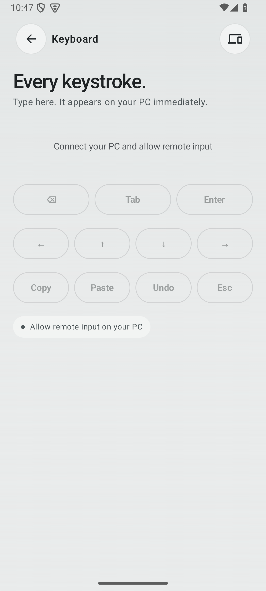 |
| Settings |  | 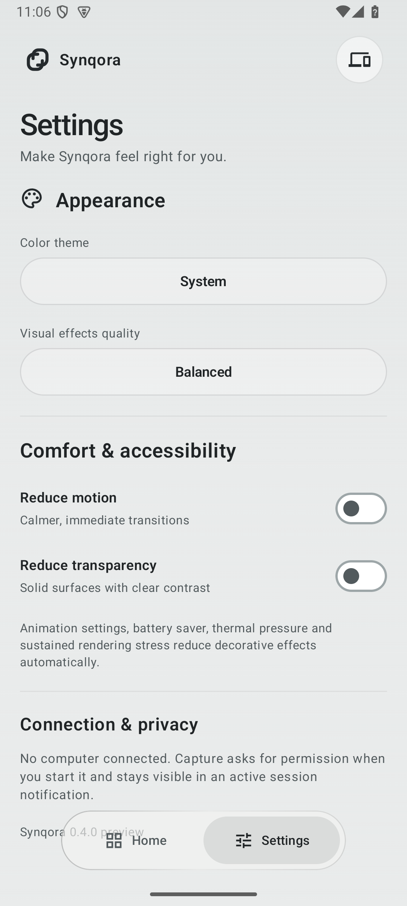 |

Size and interaction checks, measured frame times, external-device limitations and installation requirements are described in [validation](VALIDATION.md) and [installation](INSTALLATION.md).
